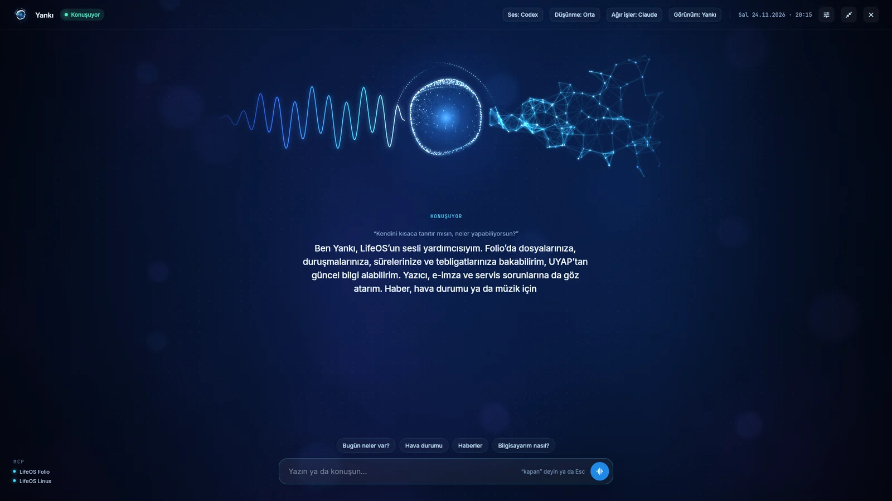
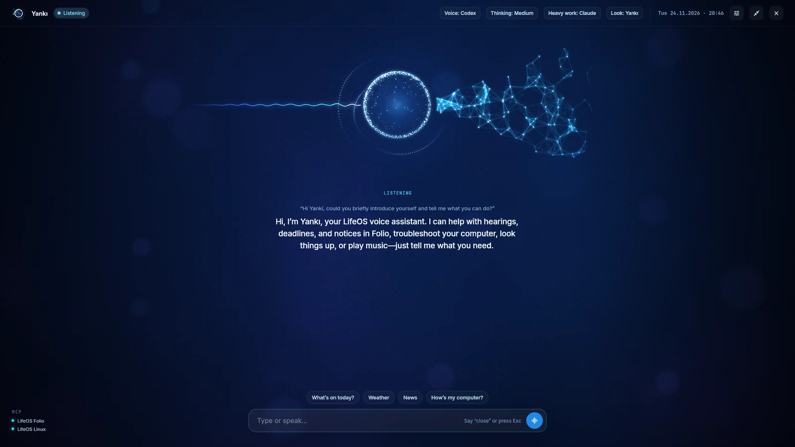

# LifeOS Yankı



[English](#english) · Türkçe

LifeOS'un sesli yapay zekâ ajanı. Yalnız Linux'ta çalışır ve LifeOS Folio'dan bağımsızdır; Folio kuruluysa onun araçlarını MCP üzerinden kullanır.

- **Dil:** Türkçe ve İngilizce. Ekran ve konuşma bilgisayarın dilini izler; Ayarlar › Genel › Dil'den değiştirilir.
- **Ses:** Codex (ChatGPT aboneliği, WebRTC realtime) ana sestir. Codex yoksa Gemini Live devreye girer.
- **Ağır işler:** Claude Code (`claude -p`) yapar ve açık MCP sunucularının yalnız okuyan araçlarını kullanır.
- **Uyandırma:** "Merhaba Yankı", "Yankı açıl" ya da "Ajan açıl" denince açılır. Tanıma Vosk ile bu bilgisayarda yapılır; hiçbir ses dışarı gitmez.
- **MCP:** Yerleşik iki sunucu var: LifeOS Folio (`lifeos_folio --mcp --dis`) ve LifeOS Linux (`lifeos mcp sun`). Ayarlar › MCP sunucuları'ndan stdio ile konuşan herhangi bir sunucu eklenebilir. Değişiklik yapan araçlar çalışmadan önce ekranda onay ister.
- **Tepsi:** Pencere kapanınca sistem tepsisinde durur. Simgeye tıklayınca açılır; menüsünden yüzen küre, "Merhaba Yankı" ile açma, ayarlar ve çıkış seçilir. Ayarlar › Masaüstü'nden kapatılabilir; oturum açılınca başlaması da oradan açılıp kapanır.
- **Sesle kapatma:** "Kapan", "görüşürüz", "teşekkürler" (İngilizcede "stop", "goodbye", "thanks") denince konuşma biter ve pencere de kapanır (Ayarlar › Ses › Sesle kapat).
- **Görünüm:** Tam ekranda üç seçenek var: *Yankı* (dalga, enerji küresi, ağ), *Ağ* (geodezik küre) ve *Dalga* (ışık halkası). Hepsi sesin gerçek seviye geçmişiyle oynar; arka plan bir GLSL shader'ıdır (`shaders/yanki_nebula.frag`). Küçültünce masaüstünde her zaman üstte duran, sürüklenebilen bir küre olur.

## Derleme ve kurulum

```bash
flutter build linux --release
```

```bash
packaging/linux/kur.sh --kullanici
```

`--kullanici` ile `~/.local` altına kurulur. Sistem geneli için seçeneksiz çalıştırın: `/opt/lifeos-yanki` ve `/usr/bin/lifeos-yanki` olarak kurulur, sudo ister. Kaldırmak için `--kaldir` kullanın.

## Komutlar

| Komut | Ne yapar |
|---|---|
| `lifeos-yanki` | Tam ekranı açar (açıksa öne getirir) |
| `lifeos-yanki --arka` | Pencere açmadan uyandırma sözünü dinler |
| `lifeos-yanki --kapan` | Açık olan Yankı'yı kapatır |

## Veriler

`~/.local/share/tr.com.lifeos.Yanki/`

- `ses.json`: ses ayarları
- `mcp.json`: MCP sunucuları
- `yanki/`: kilit dosyası

Gemini anahtarı dosyada değil, masaüstünün anahtarlığında (`secret-tool`) saklanır.

## Testler

```bash
flutter test
```

```bash
YANKI_MCP=1 flutter test test/mcp_probe_test.dart
```

```bash
YANKI_SHOTS=/tmp/yanki flutter test test/figures_render_test.dart
```

İkincisi bu bilgisayardaki gerçek MCP sunucularıyla konuşur. Üçüncüsü görünümleri PNG olarak çizer.

## Kaynak

Ses katmanı, LifeOS Folio'nun Folio Ajan'ından (`evrak convert/lib/services/voice`) ayrıldı. Folio'ya özel UYAP/UETS PIN köprüsü, dava oturumu ve Folio'nun iç yapay zekâ katmanı çıkarıldı; Folio'nun yerine geçen tek şey onun MCP sunucusudur.

## English



LifeOS's voice AI assistant, for Linux only. It stands on its own; when LifeOS Folio is installed, it uses Folio's tools over MCP.

- **Language:** Turkish and English. The screens and the conversation follow the computer's language; change it in Settings › General › Language.
- **Voice:** Codex (your ChatGPT subscription, WebRTC realtime) is the main voice; without Codex, Gemini Live takes over.
- **Heavy work:** Claude Code (`claude -p`) does it, with only the read-only tools of the enabled MCP servers.
- **Wake word:** say "Merhaba Yankı" or "Yankı açıl". It is recognised on this computer with Vosk; no audio leaves it.
- **MCP:** two servers come built in: LifeOS Folio (`lifeos_folio --mcp --dis`) and LifeOS Linux (`lifeos mcp sun`). Any stdio MCP server can be added in Settings › MCP servers. Tools that change something ask for your approval on screen first.
- **Tray:** when the window closes, Yankı stays in the system tray. Click the icon to open it; the menu has the floating orb, the wake word, settings and quit. Both the tray and starting at login can be turned off in Settings › Desktop.
- **Close by voice:** saying "stop", "goodbye" or "thanks" ends the conversation and closes the window too (Settings › Voice › Close by voice).
- **Looks:** three full-screen looks: *Yankı* (wave, energy orb, network), *Network* (geodesic sphere) and *Wave* (ring of light). All of them move with the real level history of the voice; the background is a GLSL shader. Minimised, Yankı becomes an orb that floats above the desktop and can be dragged anywhere.

Build with `flutter build linux --release`, install with `packaging/linux/kur.sh --kullanici` (or without the option for a system-wide install with sudo). Settings live in `~/.local/share/tr.com.lifeos.Yanki/`; the Gemini key is kept in the desktop keyring (`secret-tool`). License: GPL-3.0.
